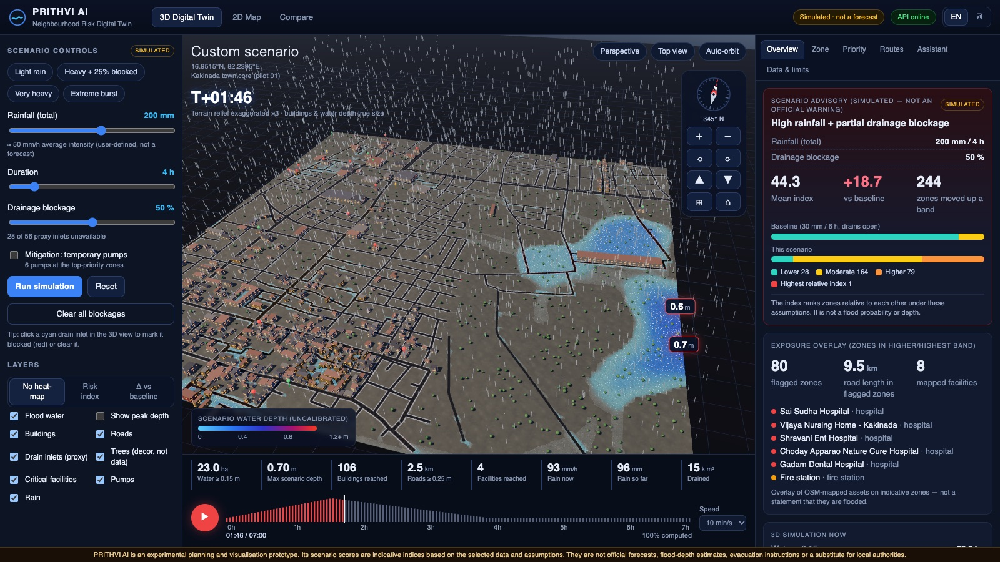
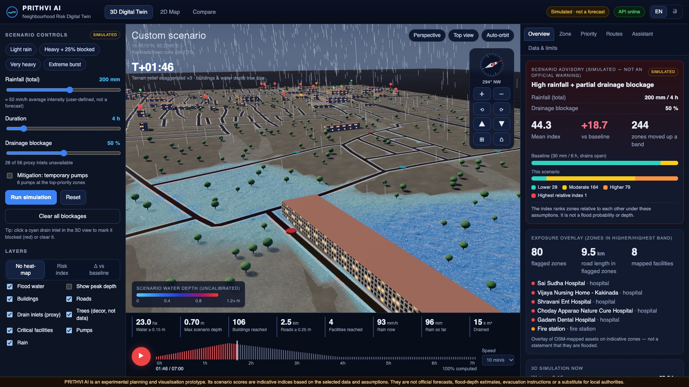
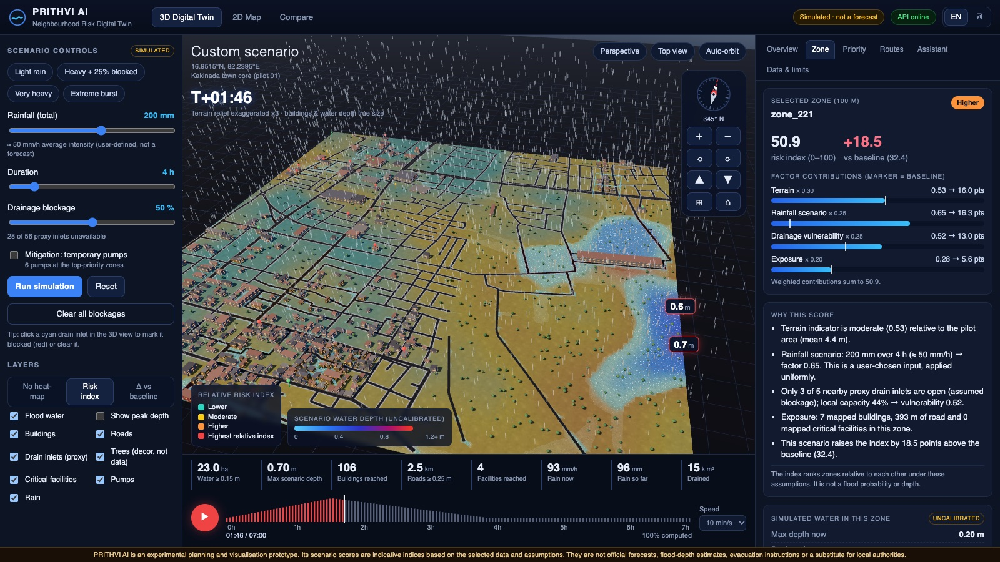
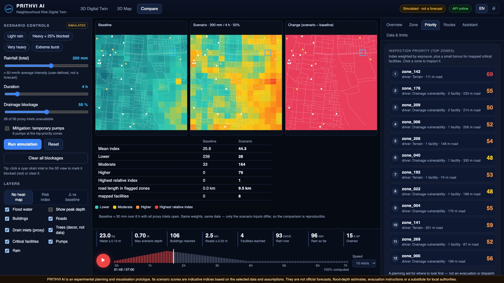
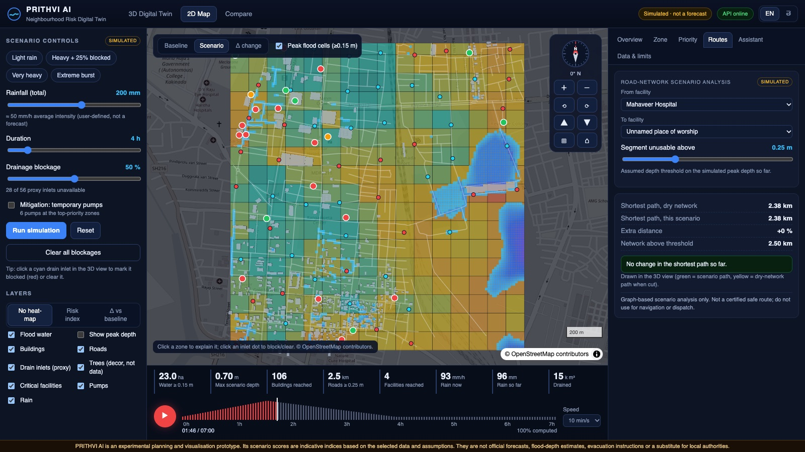
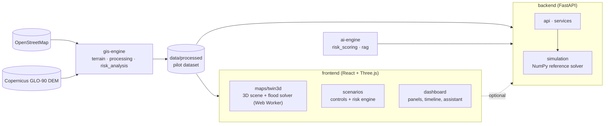

<div align="center">

# PRITHVI AI

### Neighbourhood Risk Digital Twin

A real-time **3D flood-scenario twin** of a city neighbourhood: change the rain and the drains, watch the water move through real streets, and see *why* each area scores the way it does.




</div>

> [!IMPORTANT]
> **PRITHVI AI is an experimental planning and visualisation prototype.** Its scores are *indicative indices* based on the selected data and assumptions.
> They are **not** official forecasts, flood-depth estimates, evacuation instructions, or a substitute for local authorities.
> For real warnings use the [India Meteorological Department](https://mausam.imd.gov.in/), [NDMA](https://ndma.gov.in/) and your district administration.

Built for **HackWithAditya 2026** — theme *Smart Infrastructure & Water*.

**Live demo:** [prithvi-ai-psi.vercel.app](https://prithvi-ai-psi.vercel.app) · **API:** [prithvi-ai-api.onrender.com](https://prithvi-ai-api.onrender.com/docs) (interactive docs)
> The API runs on a free tier that sleeps when idle: the first request after a pause can take up to a minute. The site keeps working meanwhile, using its in-browser engine.

---

**Hackathon:** [submission sheet](SUBMISSION.md) · [48-hour plan](docs/48-hour-plan.md) · [demo script](docs/demo-script.md) · [validation](docs/validation.md) · [AI disclosure](AI_DISCLOSURE.md)

## Contents
[Features](#features) · [Quick start](#quick-start) · [How it works](#how-it-works) · [What is real and what is assumed](#what-is-real-and-what-is-assumed) · [Controls](#controls) · [API](#api) · [Repository structure](#repository-structure) · [Development](#development) · [Deployment](#deployment) · [Roadmap](#roadmap) · [Contributing](#contributing) · [Data and attribution](#data-and-attribution) · [License](#license)

---

## Features

| | |
|---|---|
| **Real-time 3D simulation** | Rain falls, water flows downhill around real building footprints, pools in low ground and drains through (proxy) storm-drain inlets. Play, pause and scrub the timeline; buildings and roads turn amber/red as water reaches them. |
| **Live mode** | Drive the scenario from the real hourly rain forecast for the next 24–72 h (ECMWF ensemble via Open-Meteo), shown as a range with low / likely / high cases. A forecast-driven planning scenario, labelled as not an official warning. Falls back to a direct browser call or a cached copy if the API is asleep. |
| **Storm replay** | Pick a past day: run the flood model on the forecast issued the day before and on the rain that fell, then check the result against reported waterlogging (hit rate, misses, sources). Protocol in [`docs/validation.md`](docs/validation.md). |
| **Ground and sea** | Wet ground (more runoff) and a high tide or storm surge (drains back up) change both the flood run and the index. Live mode and Replay fill them from Open-Meteo (soil moisture, tide level); surge is added by hand. Assumed effects, documented in [`docs/methodology.md`](docs/methodology.md). |
| **Guided demo** | "▶ 1-minute demo" in the header walks a judge or officer through the twin, a heavier storm, inspection priority, tide and wet ground, what money buys and the self-check, setting the app up at each step. |
| **Shareable links** | "Copy link to this scenario" puts the whole what-if (rain or hourly storm, blockage, individual drains, pumps, ground and sea) in the link itself; opening it shows the same scenario. Nothing is uploaded; links are validated and clamped. |
| **Zone names** | Zones are named after the nearest OSM street (or a nearby facility) instead of "zone_142", in the lists, the zone panel, the 3D tooltip and the brief. |
| **Live alert** | In Live mode, one line answers "do we need to act?" for the forecast window (how many zones sure / maybe), with the officer brief one click away. |
| **Officer brief** | Each flagged zone is marked **sure** (flagged even with less rain and fewer blocked drains) or **maybe** (only in the worse case). One click gives a printable English / Telugu brief: nearest street, coordinates, which drains to clear, where a pump helps, which facilities to check; or copy it as text for WhatsApp. |
| **What money buys** | A cheapest-first plan (clear a blocked drain, put out pumps) with editable placeholder costs, drawn as money spent against zones still flagged; apply any step to the scenario in one click. |
| **Field reports** | Log waterlogging seen on the ground (date, place, depth); it stays on the device, counts in the Replay check and downloads in the validation-file format for review. |
| **Finer terrain + mapped drains** | `make upgrade-check` builds a 30 m terrain (Copernicus GLO-30) with OSM drains cut in, replays every reported day on old and new data, and changes nothing unless you run `make upgrade-apply`. See [`docs/terrain-and-drains-upgrade.md`](docs/terrain-and-drains-upgrade.md). |
| **Scenario what-ifs** | Set rainfall depth, duration and drainage blockage, add temporary pumps, or **click a single drain inlet** to block or clear it and watch nearby zones change. 4 presets plus a 16-scenario grid. |
| **Explainable risk index** | Per 100 m zone: an instant provisional score `100 × (0.30·T + 0.25·R + 0.25·D + 0.20·E)`, replaced by the final score `100 × (0.20·T + 0.15·D + 0.20·E + 0.45·W)` once the flood run finishes (W = simulated water in the zone), so the colours match the water. Click any zone to see each factor's weighted contribution, the baseline marker and plain-language reasons (English / Telugu). |
| **Baseline vs scenario** | 3-panel **Compare** view (baseline · scenario · change), band counts, zones that moved up, and a live exposure overlay of roads and critical facilities. |
| **Decision support** | Inspection **priority ranking**, an indicative **"drains most likely to block"** ranking (terrain and surroundings, not a prediction), graph-based **road-route analysis** (hospital → fire station, dry vs flooded network), CSV / JSON export. |
| **Evidence assistant** | Answers only from cited documents and says so when it cannot — no invented advice. |
| **Provenance first** | Every layer shows its source, licence, resolution, processing and a status tag: *observed · derived · proxy · simulated*. A limitations panel is one click away. |
| **Easy navigation** | Compass, zoom / rotate / tilt pad, keyboard and double-click-to-fly in 3D; rotate and tilt in the 2D map too. |

<table>
<tr>
<td width="50%"><br><sub><b>Street level</b> — shaded, flowing water, rain, textured buildings and lane-marked roads.</sub></td>
<td width="50%"><br><sub><b>Explainable zones</b> — risk heat-map and a factor-by-factor breakdown.</sub></td>
</tr>
<tr>
<td><br><sub><b>Compare</b> baseline and scenario, then rank where to look first.</sub></td>
<td><br><sub><b>2D map</b> with peak flood cells and road-network analysis.</sub></td>
</tr>
</table>

---

## Quick start

You need **Node 18+**. Python 3.10+ is only needed for the optional API and the tests.

```bash
git clone <your-repo-url> prithvi-ai
cd prithvi-ai/frontend
npm install
npm run dev          # → http://127.0.0.1:5173
```

That's all you need — the 3D twin runs fully in the browser and starts a simulation automatically.

**Optional backend** (shows *API online* in the header and answers assistant questions through it):

```bash
cd backend
pip install -r requirements.txt
python3 -m uvicorn main:app --port 8000      # interactive docs: http://127.0.0.1:8000/docs
```

Shortcuts are available through the `Makefile` (`make web`, `make api`, `make test`, `make data`). A WebGL-capable browser is required.

---

## How it works



1. **Data pipeline** (`gis-engine`) downloads OpenStreetMap buildings, roads and facilities plus a coarse elevation model, rasterises them to a 12.5 m grid, fills spurious pits in the terrain, and derives per-zone indicators.
2. **Risk index** (`ai-engine/risk_scoring`, mirrored in TypeScript) combines terrain, rainfall, drainage vulnerability and exposure with transparent weights; once the flood simulation finishes, the simulated water in each zone (W) becomes the largest factor.
3. **Flood solver** is a mass-conserving 2-D *virtual-pipe* shallow-water model. It runs in a Web Worker for the live 3D view; an independent NumPy implementation (`backend/simulation`) is used as a reference, and a test checks the two agree.
4. **Assistant** (`ai-engine/rag`) is extractive BM25 retrieval: it quotes cited sentences from a small document set, or abstains. No generative model is involved.

More detail: [`docs/methodology.md`](docs/methodology.md) · [`docs/architecture.md`](docs/architecture.md).

---

## What is real and what is assumed

Trustworthy tools say where their numbers come from. This one is explicit:

| Layer | Source | Status |
|---|---|---|
| Buildings, roads, facilities, water bodies | OpenStreetMap contributors (ODbL) | **observed** — coverage is thin in this area (472 footprints) |
| Terrain | Copernicus GLO-90 (~90 m *surface* model) via Open-Meteo | **derived** — smoothed, resampled, pit-filled |
| Storm-drain inlets (56) | none — **no drainage inventory exists in the data** | **proxy** — spread evenly along roads; blockage is a sensitivity assumption |
| Rainfall | user-defined scenario | **simulated** — uniform, not a forecast |
| Flood water | simplified solver on a coarse terrain model | **simulated, uncalibrated** — compare scenarios, don't read as real depth |

* No accuracy figure is claimed: there are no ground-truth flood extents. The model is checked for **mass conservation, determinism, monotonicity** (more rain or blockage never reduces risk) and **agreement between its TypeScript and NumPy implementations**.
* Terrain relief is exaggerated ×3 in the 3D view; buildings and water depth are true size. Trees are decoration only.
* The assistant's corpus is a **demo corpus** of short, team-written summaries — not official guidance.
* The Telugu translation is a first draft and needs review by a Telugu speaker.

Full list: [`docs/limitations.md`](docs/limitations.md).

---

## Controls

| | 3D Digital Twin | 2D Map |
|---|---|---|
| Rotate | left-drag · **⟲ ⟳** · `Q` / `E` · `←` `→` | right-drag or Ctrl-drag · **⟲ ⟳** |
| Tilt | `↑` `↓` · **▲ ▼** (top-down ↔ street level) | right-drag up/down · **▲ ▼** |
| Pan | right-drag or Shift-drag · `W A S D` | left-drag |
| Zoom | scroll · **＋ －** (hold to repeat) | scroll · **＋ －** |
| Fly to a spot | double-click the ground | — |
| **Compass** | dial rotates with the view and shows the heading; click it (or press `N`) to face north | same |
| Top-down / reset | **⊞** / **⌂** · `T` / `0` | same |

The camera cannot leave the model, so you can't get lost.

---

## API

FastAPI, 11 routes, contract in [`docs/contracts/openapi.json`](docs/contracts/openapi.json) with JSON Schemas alongside.

| Method | Path | Purpose |
|---|---|---|
| GET | `/health` | service health |
| GET | `/api/v1/areas` · `/areas/{id}/layers` · `/baseline` · `/facilities` | pilot area, provenance, baseline map, mapped facilities |
| POST | `/api/v1/scenarios` | create and compute a scenario (`simulate: true` also runs the NumPy flood solver) |
| GET | `/api/v1/scenarios/{id}` · `/geojson` · `/compare` | stored scenario, zone GeoJSON, baseline-vs-scenario comparison |
| GET | `/api/v1/zones/{zone_id}/explanation` | factor breakdown and reasons |
| POST | `/api/v1/assistant/query` | cited, extractive answer — or an explicit abstain |

Every response carries a `data_status` and its assumptions; numeric inputs are validated.

---

## Repository structure

```
prithvi-ai/
├── frontend/                  React + TypeScript + Vite + Three.js + MapLibre
│   ├── public/data/           pilot dataset + assistant corpus served to the browser
│   ├── scripts/               scenario report, TS↔Python parity fixture
│   └── src/
│       ├── components/        header, compass / zoom pad, i18n (EN / తె), API client
│       ├── maps/
│       │   ├── twin3d/        3D digital twin: scene/ (Three.js) + sim/ (Web Worker flood solver)
│       │   └── map2d/         2D map (MapLibre) and the Compare view
│       ├── dashboard/         risk/ · timeline/ · assistant/ · provenance/
│       └── scenarios/         scenario controls + engine/ (risk index, routing, dataset)
├── backend/                   FastAPI: api/ · models/ · services/ · simulation/ · tests/
├── gis-engine/                terrain/ · processing/ · risk_analysis/   (data pipeline)
├── ai-engine/                 risk_scoring/ · rag/                       (index + retrieval, with tests)
├── data/                      processed/ (pilot data, provenance) · sample/ · raw/ (git-ignored cache)
├── docs/                      architecture · methodology · data-sources · limitations · api-contract · demo-script
│   └── contracts/             OpenAPI + JSON Schemas
└── Makefile · docker-compose.yml · pytest.ini · .github/ (CI, templates)
```

---

## Development

```bash
make test                 # 73 Python tests + 69 web tests + typecheck
python3 -m pytest -q      # Python only (risk index, parity with TypeScript, solver, RAG, API)
cd frontend && npm test   # solver tests (mass conservation, determinism, monotonicity)
make data                 # re-download OSM + DEM and rebuild data/processed (cached in data/raw)
```

* **Keep the two risk engines in sync.** After changing `frontend/src/scenarios/engine/risk.ts` or `ai-engine/risk_scoring/engine.py`, run `cd frontend && npx vite-node scripts/export-reference.ts`, then `python3 -m pytest` — the parity test fails if they disagree. If you change the solver, the dataset or `zoneWater()`, also regenerate the baseline water file: `npx vite-node scripts/export-baseline-water.ts`. The two flood solvers are checked the same way: after changing `floodSolver.ts`, `storm.ts` or `backend/simulation/`, run `cd frontend && npx vite-node scripts/export-solver-reference.ts`.
* **Changing the pilot area:** edit the bounding box in `gis-engine/gis_config.py` and run `make data`. Check that DEM, roads, buildings and facilities exist for the new area first.
* `docker-compose.yml` is provided for the API and web dev server; it has not been verified yet.
* CI (GitHub Actions) runs the Python tests, the web typecheck, tests and production build on every push and pull request.

---

## Deployment

The 3D twin is a static site, so it deploys in minutes to Vercel, Netlify, Cloudflare Pages or GitHub Pages; the FastAPI backend is optional. Step-by-step instructions and a pre-launch checklist are in **[docs/deployment.md](docs/deployment.md)**.

---

## Roadmap

- [ ] Calibrate and validate against a documented historical flood event (held-out extent, IoU / precision / recall)
- [ ] Surveyed drainage network and culverts instead of proxy inlets
- [ ] Real rainfall input (e.g. NASA GPM IMERG) with spatial variation
- [ ] More pilot areas and a PostGIS-backed data layer (schema in `backend/models/schema.sql`)
- [ ] Official preparedness documents in the assistant corpus, reviewed Telugu translation
- [ ] Higher-resolution terrain (LiDAR / survey DEM); a 30 m GLO-30 upgrade with a before/after replay check is ready (`make upgrade-check`)

---

## Contributing

Contributions are welcome — please read [CONTRIBUTING.md](CONTRIBUTING.md) first. The one rule that matters most here: **never present simulated or assumed values as measured, and never claim accuracy that has not been validated.**

Security issues: see [SECURITY.md](SECURITY.md). Everyone taking part is expected to follow the [Code of Conduct](CODE_OF_CONDUCT.md).

---

## Data and attribution

* Map data © **OpenStreetMap contributors**, available under the [ODbL 1.0](https://www.openstreetmap.org/copyright).
* Terrain: **Copernicus DEM GLO-90**, sampled via the Open-Meteo elevation API.
* Third-party libraries keep their own licences.

Details in [NOTICE.md](NOTICE.md).

## AI-tool disclosure

This project was built with an AI coding assistant (Claude), as allowed by the hackathon rules when disclosed. Details, including what the team did and what the in-app assistant is (keyword retrieval, not an LLM), are in [AI_DISCLOSURE.md](AI_DISCLOSURE.md). The team reviews, understands and is responsible for every part of the code it submits ([viva preparation](docs/viva-prep.md)).

## License

**No licence has been chosen yet.** Until one is added, all rights are reserved: you are welcome to read the code, but you may not copy, modify or redistribute it. If you would like to reuse it, please open an issue.
